


 

  

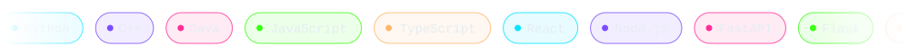
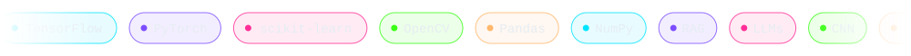


## `> whoami`

  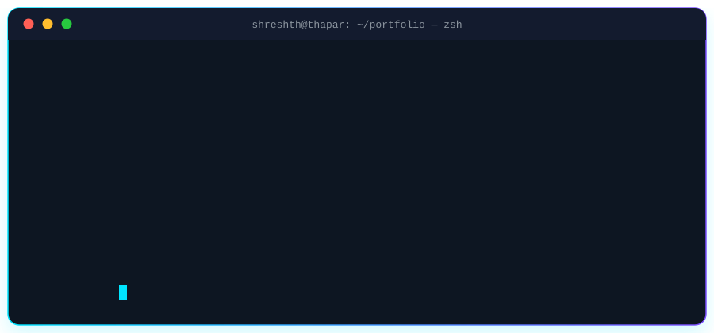

 

## `> ./tech_orbit`

<table>
<tr>
<td width="48%" align="center">
  
</td>
<td width="52%" valign="middle">

**🧠 Currently exploring**
- Agentic RAG and LLM-powered apps
- MLOps: reproducible training → deployment
- Deep learning for computer vision
- Full-stack apps with real UX polish

**🎯 Currently aiming for**
- Summer 2027 SDE / ML Engineering internships
- Google · Amazon · Apple

**⚡ Philosophy**
> **

</td>
</tr>
</table>

<b>🧰 Expand full tech stack</b>

 

| Layer | Tools |
|:--|:--|
| **Languages** | `Python` `C++` `Java` `JavaScript` `TypeScript` `SQL` |
| **ML / AI** | `TensorFlow` `PyTorch` `scikit-learn` `OpenCV` `RAG` `LLMs` `CNNs` |
| **Backend** | `FastAPI` `Flask` `Node.js` `Express` |
| **Frontend** | `React` `HTML` `CSS` `Tailwind` |
| **Data** | `Pandas` `NumPy` `MongoDB` `PostgreSQL` `MySQL` |
| **DevOps / MLOps** | `Docker` `Git` `GitHub Actions` `CI/CD` |

## `> ls ./projects`

<table>
<tr>
<td><a href="https://github.com/Shreshth1805?tab=repositories">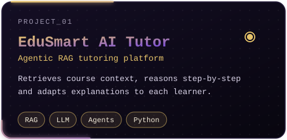</a></td>
<td><a href="https://github.com/Shreshth1805?tab=repositories">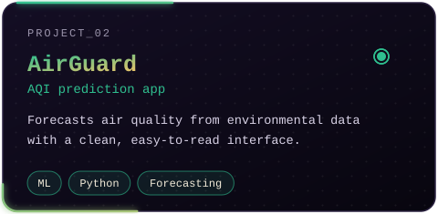</a></td>
</tr>
<tr>
<td><a href="https://github.com/Shreshth1805?tab=repositories">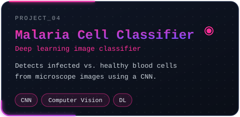</a></td>
</tr>
<tr>
<td colspan="2" align="center"><a href="https://github.com/Shreshth1805?tab=repositories">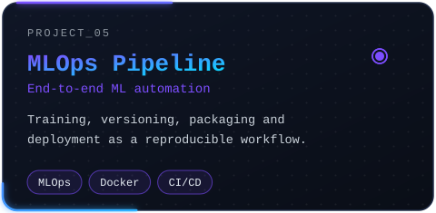</a></td>
</tr>
</table>

<!-- TIP: replace each ?tab=repositories link above with the exact repo URL, e.g. https://github.com/Shreshth1805/AirGuard -->

<b>📂 Project quick-reference</b>

 

| # | Project | Domain | Core Tech |
|:-:|:--|:--|:--|
| 01 | **EduSmart AI Tutor** | Agentic AI / EdTech | RAG · LLMs · Agents |
| 02 | **AirGuard** | Environmental ML | Forecasting · Python |
| 03 | **Cafe Razzmatazz** | Web | Full-stack · UI/UX |
| 04 | **Malaria Cell Classifier** | Healthcare CV | CNN · Deep Learning |
| 05 | **MLOps Pipeline** | ML Engineering | Docker · CI/CD |

## `> git stats`

## `> snake --eat contributions`

<picture>
  <source media="(prefers-color-scheme: dark)" srcset="https://raw.githubusercontent.com/Shreshth1805/Shreshth1805/output/github-snake-dark.svg" />
  <source media="(prefers-color-scheme: light)" srcset="https://raw.githubusercontent.com/Shreshth1805/Shreshth1805/output/github-snake.svg" />
  
</picture>

## `> connect --me`

  


